 

  
  
  
  

 

  

  
  
  
  
  
  

 

  

<!-- Generated every day by .github/workflows/update-profile.yml -->

<picture>
  <source media="(prefers-color-scheme: dark)" srcset="https://raw.githubusercontent.com/colasnaudi/colasnaudi/output/snake-dark.svg" />
  
</picture>

  

