  
  
  
  

 

<table>
<tr>
<td width="55%" valign="top">

I'm a full-stack developer based in Paris, originally from the French Basque Country.

I enjoy building digital products end to end, from architecture and backend development to user interfaces, mobile applications and deployment.

I'm particularly interested in **product engineering**: understanding a problem, designing a solution and taking it all the way to production.

My main areas of focus are **React, Next.js, TypeScript, React Native** and backend development.

</td>
<td width="45%" valign="top">

<b>EDUCATION</b> 
**Master MIAGE**, Université Toulouse Capitole

<b>EXPERIENCE</b> 
**4 years of work-study** at NOBATEK/INEF4 and Cegedim Assurances

<b>ENTREPRENEURSHIP</b> 
**Co-founder of [Besta](#besta)**, a digital product studio

<b>INDEPENDENT PRODUCT</b> 
**Building [Cueflow](#cueflow)**, a macOS app for DJs

<b>CURRENTLY</b> 
🟠 **Open to full-stack developer opportunities**

</td>
</tr>
</table>

 

<table>
<tr>
<td width="50%" valign="top">

### Cueflow
<b>INDEPENDENT PRODUCT · BETA</b>

**A macOS app made by a DJ, for DJs.**

Cueflow started as a tool to improve my own DJ workflow and is now being tested in beta by around ten DJs, from beginners to experienced users.

- Building a native macOS application with Swift
- Designing a product around real DJ workflows
- Implementing licence management and payment flows
- Preparing the launch of a paid perpetual licence

</td>
<td width="50%" valign="top">

### Besta
<b>CO-FOUNDER · 15,000+ DOWNLOADS</b>

**Event discovery and ticketing platform.**

A mobile app for events and outings across the South-West of France, plus professional and admin tools for organisers and venues.

- Cross-platform mobile app development and maintenance
- Professional back-office and administrator area
- Subscription plans and payments with Stripe
- Ticketing system and checkout flows
- Event and venue management features
- Product, technical architecture and delivery

</td>
</tr>
<tr>
<td width="50%" valign="top">

### Job Hunter
<b>PERSONAL PROJECT · LIVE</b>

**An AI-powered job-search assistant.**

Designed to centralise job opportunities and make the application process easier to manage.

- Aggregates job offers from multiple sources
- Helps rank opportunities and prepare applications
- Uses AI to assist with application writing
- Connects with an inbox to keep application statuses up to date

</td>
<td width="50%" valign="top">

### ORBIT
<b>CEGEDIM ASSURANCES · AI TOOLING</b>

**AI-assisted development tool.**

Analyses Jira tickets by gathering context from multiple sources and document formats. My contributions included:

- A Jira integration through a custom MCP server
- Information extraction from text and office documents
- Screenshot processing with Claude Vision
- Gathering and structuring context for ticket analysis

</td>
</tr>
<tr>
<td width="50%" valign="top">

### LNA Natation
<b>CLIENT PROJECT · WITH BESTA</b>

**iOS / Android app and web back-office.**

A digital platform for the Ligue Nouvelle-Aquitaine de Natation.

- Cross-platform mobile application
- Web back-office for managing and publishing content
- WordPress integration through the REST API

</td>
<td width="50%" valign="top">

### NOBATEK/INEF4
<b>R&D · SUSTAINABLE CONSTRUCTION</b>

**Software development in a research and innovation environment.**

- Web applications for energy monitoring
- A Unity-based flood simulation of Dordrecht for a European project
- An iPad AR app displaying a building's digital model on a live construction site

</td>
</tr>
</table>

 

<table>
<tr>
<td align="center" width="33%">
<b>FRONTEND & MOBILE</b>  

</td>
<td align="center" width="33%">
<b>BACKEND & DATA</b>  

</td>
<td align="center" width="33%">
<b>TOOLS & INFRA</b>  

</td>
</tr>
</table>

 

<!-- Generated every day by .github/workflows/update-profile.yml -->

<picture>
  <source media="(prefers-color-scheme: dark)" srcset="https://raw.githubusercontent.com/colasnaudi/colasnaudi/output/snake-dark.svg" />
  
</picture>

  

